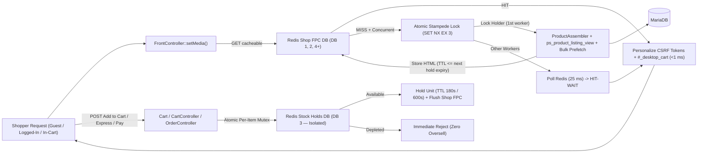

# PrestaShop 8 Front-Office Performance & Flash-Sale Protection (`ps_redis_perf`)

An open-source PrestaShop 8 performance suite built for **Apache / Nginx + PHP-FPM + Redis + MariaDB**, focused on high-traffic front-office speed and high-contention limited-edition product drops.

---

## Architecture Overview

### Redis Database Isolation

| Redis DB | Purpose | Flushing Behavior |
| :--- | :--- | :--- |
| `DB 0` | PHP Sessions (`session.save_handler = redis`) | Never touched by module flushes |
| `DB 1`, `DB 2`, `DB 4+` | Per-shop Full-Page Microcache (auto-mapped per `id_shop`, skipping Reserve DB) | Flushed per shop on stock/order/BO events |
| `DB 3` *(configurable)* | Atomic Stock Reservations (`sres:*`) | Completely isolated from FPC `FLUSHDB` |

---

## Production Benchmarks

Measured on a real multi-shop PrestaShop 8.x store (**Apache + PHP 8.4-FPM + Redis + MariaDB**, heavy category pages with product combinations and filters):

| Test Scenario | Result |
| :--- | :--- |
| **Sustained Load Test (20 RPS mixed category + product traffic)** | **314 / 314 HTTP 200**, **222 / 222** HTML integrity checks passed, **`p50 = 86.8 ms`**, **`p95 = 228.0 ms`**, **`p99 = 450.2 ms`** |
| **Cold-Cache Stampede (10 simultaneous cold requests after flush)** | **`1 MISS` + `9 HIT-WAIT`** (1 MariaDB/Smarty render instead of 10) |
| **Flash-Sale Contention (10 concurrent buyers carting 2 units)** | **`2 Succeeded` / `8 Blocked`** — **0 oversells**, holds auto-expire after configured TTL |
| **Category Listing Cold Miss (`ps_product_listing_view` + bulk prefetch)** | **~5–10× fewer SQL queries** compared to vanilla `ProductAssemblerCore` |

---

## Key Features

### 1. Redis Full-Page Microcache (Guest + Logged-In Drop Mode)
* **Native PHP-level FPC:** Works on standard Apache/Nginx without migrating to LiteSpeed or maintaining Varnish VCL/ESI rules.
* **Per-Shop Isolated Redis DBs:** Keeps PHP sessions (`DB 0`), per-shop page caches (`DB 1, 2, ...`), and stock reservations (`Reserve DB`, default `3`) isolated so flushing a shop's page cache never drops active sessions or stock holds.
* **Option 1 — Logged-In Empty-Cart Caching:** Caches catalog/product HTML per customer group for authenticated shoppers, scrubbing customer PII from `var prestashop` JSON and dynamically swapping each user's personal CSRF tokens (`static_token` & `token`) on every cache hit.
* **Option 2 — In-Cart Caching (`cartCount > 0`):** Serves cached catalog/product pages even when a shopper already has items in their cart, dynamically injecting their personal `#_desktop_cart` widget and `products_count`.
* **Automatic Per-Customer Specific-Price Bypass:** Dynamically detects customers with custom `ps_specific_price` rows (cached in Redis for 5 min) and bypasses FPC for them.
* **Cold-Cache Stampede Protection (Dog-Pile Lock):** Uses an atomic Redis `SET NX EX` lock so when 10+ buyers hit an uncached page simultaneously after a flush, only 1 worker renders from MariaDB/Smarty while concurrent requests wait briefly and receive `X-Page-Cache: HIT-WAIT`.
* **Sliding TTL (Prolong on Hit):** Optionally refreshes a cached page's TTL back to the configured lifetime on active hits (throttled to at most once every 5s per page and clamped to the earliest expiring active stock hold) so hot catalog pages stay warm while preserving exact drop hold expiry.
* **Stampede Telemetry & PRG Back Office Controls:** Records the last 20 `HIT-WAIT` stampede saves (`fpc:stats:recent_wait_hits`) in Redis and renders them in a full-width Back Office dashboard table alongside live hit/miss/block counters and Post-Redirect-Get (PRG) cache/hold controls.

### 2. Zero-Oversell Atomic Stock Reservations (Drop Protection)
* **Option A — Reserve Stock on Add-to-Cart (`CartController` + `Cart`):** Uses a per-item Redis mutex lock (`SET NX PX`) to atomically reserve units for a configurable TTL (default `180s` / 3 min). Eliminates overselling when many buyers click *Add to Cart* on limited stock at the exact same millisecond, covering both standard `CartController` add-to-cart and direct `Cart::updateQty()` / `Cart::deleteProduct()` / `Cart::delete()` mutations used by product-page 1-click Express Checkouts (Apple Pay, Google Pay, PayPal Express) without modifying payment modules.
* **Express Checkout Cart Duplication Aliasing (`Cart::duplicate()`):** When Express checkout modules (e.g., Buckaroo Apple Pay / Google Pay / PayPal Express) clone an active shopper's cart before payment authorization, the duplicate cart is linked in Redis (`sres:cart_alias:*` / `sres:cart_children:*`) to the canonical source cart and atomically validated via `tryReserveWholeCart()`. This prevents self-blocking against the shopper's own hold, continues blocking concurrent shoppers, keeps the source cart's hold intact if an abandoned Express duplicate is deleted, and releases both source and duplicate holds together on order validation (`releaseAllCartReservations()`). If the original hold expired and another shopper already claimed the stock, duplication aborts cleanly (`success: false`).
* **Option B — Reserve Stock on Proceed-to-Payment:** Atomically holds all cart items for a configurable TTL (default `600s` / 10 min) right before external payment-gateway redirection (`OrderController::displayAjaxCheckCartStillOrderable`, PayPal `ecinit`/`scinit`, and Buckaroo `applepayexpress`/`googlepayexpress`/`paypalexpress` `action=authorize` and `request`).
* **Hold-Aware FPC TTL Clamping:** Caps page-cache TTL to the earliest expiring active stock hold so abandoned carts automatically reappear in stock right when their hold expires.

### 1-Click / Express Checkout Compatibility
* Works out-of-the-box with **zero modifications to third-party payment modules** (`buckaroo3`, `paypal`, or any module using standard PrestaShop `Cart` APIs).
* **Option A** automatically protects any Express checkout flow that calls `Cart::updateQty()`, `Cart::duplicate()`, `Cart::deleteProduct()`, or `Cart::delete()`.
* **Option B** payment-stage guards explicitly recognize `OrderController::displayAjaxCheckCartStillOrderable()`, PayPal Express (`ecinit`, `scinit`), and Buckaroo Express (`applepayexpress`, `googlepayexpress`, `paypalexpress` with `action=authorize`, and `request`).

### 3. Cold-Miss Database, Session & Query Optimizations
* **MariaDB Category Listing View (`ps_product_listing_view`) + Bulk Prefetching:** Offloads category product assembly, combination stock, and price hydration to a MariaDB view (auto-created on install) paired with bulk prefetchers for images, combination images, features, and stock (`ProductAssembler`, `Product`, `StockAvailable`).
* **Session DB Write Throttling (`Cookie::getSession`):** Avoids running `UPDATE` queries on `ps_customer_session` / `ps_employee_session` on every page load by throttling writes to a configurable interval (default `300s`).
* **Internal SQL Query Cache Bypass (`Cache::setQuery`):** Disables PrestaShop's legacy table-to-query cache map to eliminate serialization/write contention.
* **Bulk Group Reduction & Multi-Format Image Duplication:** Single-query bulk `GroupReduction::duplicateReduction()` and multi-format (`jpg`/`webp`/`avif`/`2x`) file copy in `ProductDuplicator`.
* **Lazy Listing Gallery Images & Cached Image Metadata (`ProductPresenterFactory`):** Resolves only the cover (and combination default) image eagerly on category/listing pages while lazily computing `$product['images']` on demand via `AbstractLazyArray::appendClosure()`, eliminates `N` redundant `new Product()` DB queries, and caches `ImageFormatConfiguration` / `ImageType` / `PS_HIGHT_DPI` once per request.
* **Single-Product Combination Stock Auto-Prefetch & Per-Request Image Cache (`StockAvailable` + `Product`):** Automatically prefetches all combinations' stock for a product on its first Front-Office miss (`19× → 1×` SQL on multi-combination product pages, keeping `-0` context-shop alias keys invalidated via `Cache::clean()`), and caches `Product::getImages()` / `getCombinationImages()` per request in Front Office (`3× → 1×`).

---

## Requirements

* PrestaShop **8.x**
* PHP **8.1+** with the **`phpredis`** extension (`ext-redis`)
* **Redis** server (recommended: `maxmemory-policy volatile-lru`)
* **MariaDB 10.2+** or **MySQL 8.0+** (window functions `ROW_NUMBER()` and `JSON_OBJECT()` are used if the optional SQL listing view is enabled)

---

## Installation

### Option A — PrestaShop Back Office (Recommended)
1. Download the latest `ps_redis_perf-*.zip` from the [GitHub Releases](https://github.com/Bugfunder/ps_redis_perf/releases) page (includes pre-built Composer autoloader).
2. Upload and install via **Back Office → Modules → Module Manager → Upload a module**.

### Option B — From Source (Git)
1. Clone this repository into your PrestaShop `modules/ps_redis_perf/` directory.
2. Run `composer dump-autoload --no-dev -o` inside `modules/ps_redis_perf/` (generates PSR-4 autoloading for the optional `ProductDuplicator` Symfony service).
3. Install via **Back Office → Modules → Module Manager** (or CLI `php bin/console prestashop:module install ps_redis_perf`).

### Post-Install
* On install, the module registers its hooks, initializes safe default configuration, and creates the `ps_specific_price_best` and `ps_product_listing_view` MariaDB views if they do not already exist.
* Clear PrestaShop's class index and Symfony production cache (`var/cache/prod`), and reload PHP-FPM if OPcache timestamp validation is disabled.
* Configure everything under **Modules → Redis Performance & Drop Protection → Configure**.

---

## Registered PrestaShop Hooks

On install, `Ps_redis_perf::registerRequiredHooks()` registers the following 11 hooks:

* `actionProductUpdate`, `actionProductDelete`, `actionProductSave`, `actionCategoryUpdate`, `actionOrderStatusPostUpdate` — flush affected shop Redis FPC DBs on Back Office catalog/order edits (when auto-flush is enabled)
* `actionObjectImageAddAfter`, `actionObjectImageUpdateAfter`, `actionObjectImageDeleteAfter` — flush affected shop Redis FPC DBs and touch product `date_upd` / product cache
* `actionUpdateQuantity` — always flush affected shop Redis FPC DBs when stock quantities change
* `actionObjectProductInCartDeleteAfter` — immediately release the per-item Redis stock hold when a cart line is deleted
* `actionValidateOrder` — immediately release all Redis stock holds (including linked Express duplicate aliases) for the completed cart and flush shop Redis FPC

---

## Core Overrides Included

This module overrides the following PrestaShop core classes (check for conflicts if you use other override-heavy modules):

* `override/classes/controller/FrontController.php` — Redis FPC, stampede lock, CSRF token/cart personalization, PayPal & Buckaroo Express Option B guards
* `override/classes/stock/StockAvailable.php` — Redis connection/DB mapping, atomic stock reservations, canonical cart alias resolution, bulk & single-product combination stock prefetching
* `override/classes/Cart.php` — Atomic stock reservations for direct `Cart::updateQty()` / `Cart::duplicate()` (1-click Express Checkouts) and immediate hold release on `deleteProduct()` / `delete()`
* `override/controllers/front/CartController.php` — Option A add-to-cart reservation
* `override/controllers/front/OrderController.php` — Option B pre-payment reservation guard
* `override/classes/ProductAssembler.php` — MariaDB listing view fast-path + bulk prefetching
* `override/classes/Product.php` — Bulk & per-request Front-Office image/combination-image caches and bulk front feature prefetching
* `override/classes/Cookie.php` — `ps_logged` cookie sync & throttled session DB writes
* `override/classes/cache/Cache.php` — Configurable `Cache::setQuery()` bypass
* `override/classes/GroupReduction.php` — Bulk single-query `duplicateReduction()`
* `override/classes/ProductPresenterFactory.php` — Cover-only eager listing image resolution with lazy gallery fallback, zero-DB Product instantiation, and per-request image format/type caching

---

## Caveats & Notes for Third-Party Themes

* **Option 2 (In-Cart Caching)** is disabled by default on fresh installs because it expects Classic-theme `#_desktop_cart` header markup. If your theme uses a custom AJAX cart widget or different DOM wrapper, leave Option 2 disabled or adapt `prepareHtmlForFpcStorage()` / `renderFpcDesktopCartHtml()`.
* **SQL Listing View:** Automatically falls back to `ProductAssemblerCore` for non-standard customer groups (e.g., B2B wholesale groups) or if the SQL view is disabled/missing.

---

## License

MIT License — see [LICENSE](LICENSE).
